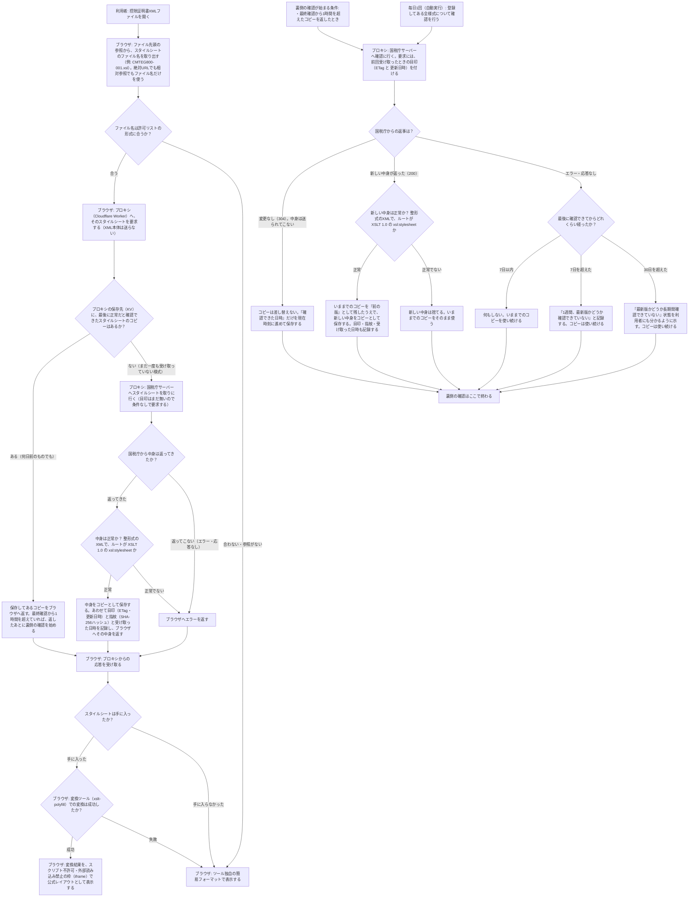

# 控除証明書XMLビューア 公式スタイルシート対応 設計メモ

- 状態: ドラフト（調査・意思決定の記録。実装はこのブランチで継続する）
- 対象: `src/kojo-xml-viewer/`（公開URL: https://okathira-dev.github.io/client-web-api-sandbox/kojo-xml-viewer/index.html ）
- ブランチ: `feat/kojo-xml-official-stylesheet`
- 最終更新: 2026-11-05

このドキュメントは、公式スタイルシート対応について「やりたいこと」「実測で分かったこと」「決めたこと」「未決のこと」を分けて記録する。推測と実測を混同しないこと。

---

## 1. やりたいこと

現行ビューアは、控除証明書XMLを独自フォーマットで整形表示している（「XML簡易帳票」）。これを、**XMLが本来参照している国税庁の公式スタイルシートで変換し、公式レイアウト（帳票イメージ）で表示できる**ようにする。

要件として同時に満たすもの:

1. 公式スタイルシートで表示できること
2. 様式が改訂されたら、サイトを再デプロイしなくても新しい版に追随できること（動的取得）
3. 利用者のXML本体を端末の外に出さないこと（現行ツールの公約「XMLファイルの外部送信を行いません。すべての処理はクライアントサイドで実行されます」を維持する）

対象範囲はまず控除証明書系の様式（TEG800〜913。生命保険料・地震保険料・国民年金・小規模企業共済・住宅借入金等）とする。

やらないこと:

- XMLのデジタル署名検証（現行通り行わない）
- サーバーサイドでのXML変換（要件3に反する）
- 他人が運営するプロキシの利用（税データ表示に関わるコードを第三者に委ねない）
- 公式XSLの書き換え（取得した原本をそのまま使う。書き換えが必要になる変換エンジンは採らない）

## 2. 実測で分かったこと（2026-10-30〜11-03）

### 2.1 XML側の参照

実物の生命保険料控除証明書XML（第一生命発行）の先頭は次の通りで、`xml-stylesheet` 処理命令（PI）が国税庁のXSLを絶対URLで指している。

```xml
<?xml version="1.0" encoding="UTF-8"?>
<?xml-stylesheet type="text/xsl" href="http://xml.e-tax.nta.go.jp/xsl/1.0/CMTEG800-001.xsl" ?>
```

一方、国税庁がマイナポータル連携API向けに公開している TEG840 のサンプルXML（`sample/` の6件）は、PI が**相対参照**になっている。

```xml
<?xml-stylesheet type="text/xsl" href="CMTEG840-001.xsl"?>
```

したがって、PI の URL をそのまま解決する方式では足りない。PI からファイル名（`CM` + 様式ID + `-` + 版 + `.xsl`）を取り出し、公式の配置場所（`https://xml.e-tax.nta.go.jp/xsl/1.0/`）に当てはめて解決する（§4 D6）。

### 2.2 HTTPSで直接取得できる（混在コンテンツ問題は読み替えで解ける）

- `https://xml.e-tax.nta.go.jp/xsl/1.0/CMTEG800-001.xsl` は **200** で直接取得できた（2026-11-02 に再確認）
  - 126,183 バイト、`Content-Type: application/xslt+xml`
  - `Last-Modified: Sat, 23 May 2026 10:26:44 GMT`
  - `ETag: "1ece7-65279950604c0"`
  - SHA-256: `71bb542f570814a3593a3d930a155c3e7b4af22ab4760d7bc856241b099ec4bb`
  - 同じ場所で TEG810（61,467 バイト）、TEG822（32,765）、TEG830（379,768）、TEG840（78,842）、TEG850（70,704）も 200
- `http://` の方は CloudFront が https へ **301 リダイレクト**する。追随して得た本文は、https 直接取得と SHA-256 が一致した
- 最初から https で取りに行く。http の 301 リダイレクトに依存してはいけない（http の応答自体は途中で差し替えられ得るため）
- 上記6様式のXSLはいずれも XSLT 1.0（`version="1.0"`）で、`xsl:include` / `xsl:import` / `document()` / `msxsl:` 拡張を使っていない。外部の画像・CSS・フォントも参照していない（取得した実ファイルで確認）。様式を追加するときは同じ確認を行うこと

### 2.3 CORSは依然として壁（プロキシが必要な理由）

- https 側に `Origin` ヘッダーを付けて要求しても、応答に `Access-Control-Allow-Origin` は**付いてこない**（2026-11-02 に再確認）
- サーバーには届き 200 も返るが、別オリジンから fetch した JavaScript は中身を読めない。スキーム読み替えでは解決しない
- `no-cors` では中身が読めず（opaque）、Service Worker でも CORS は回避できない
- 結論: 「公式レイアウト」「動的取得」「XMLを端末から出さない」を同時に満たすには、**自前のプロキシ（サーバー側で取得し、許可ヘッダーを付けて返す中継）が必須**。サーバー同士の取得には CORS が適用されないため成立する
- 将来、国税庁が CORS ヘッダーを付けるようになればプロキシは不要になる。解決処理は「プロキシ経由」決め打ちにせず、差し替え可能な抽象にしておくこと

### 2.4 条件付きリクエストが効く（再検証は安い）

- `If-None-Match`（ETag）付き再要求 → **304・本文0バイト**（実測）
- `If-Modified-Since` 付き再要求 → **304・本文0バイト**（実測）
- 原点は `Cache-Control` を送ってこないため、鮮度方針は全面的にこちらで決める必要がある
- RFC 9111 では、ETag がある場合に `If-None-Match` を送るのはキャッシュの標準動作（MUST）

### 2.5 ブラウザ標準のXSLTは廃止される

- Chrome 公式発表: Chrome 158（2026-11-17）で `XSLTProcessor` と XSLT の PI（`type="text/xsl"`）が Stable で停止する。Enterprise Policy（`XSLTEnabled`）と Origin Trial は Chrome 176（2027-08-17）まで
  - 出典: https://developer.chrome.com/docs/web-platform/deprecating-xslt
- Firefox と WebKit も、XSLT をエンジンから削除する方針を示している（同ページ）
- 同ページは代替として、libxslt を WebAssembly にした polyfill と、SaxonJS を挙げている。この2つを §2.7 で比較した

### 2.6 公式スタイルシートの配布形態

- 国税庁 e-Tax「電子的控除証明書等に係る仕様書一覧」で、スタイルシート一式が CAB 形式（約132KB）で配布されている。更新日は令和8年5月18日
  - https://www.e-tax.nta.go.jp/shiyo/shiyo-kojo3.htm
- 初期投入（§4 D4）の取得元は、この https 配布（CAB）とする

### 2.7 変換エンジンの比較（PoC、2026-11-03）

公式XSL（原本のまま）とリポジトリのサンプルXML 7件（TEG800 1件、TEG840 6件）を、ブラウザ上で変換して比べた。基準は、PoC 時点のブラウザ（Chrome 152）にまだ残っている標準の `XSLTProcessor` の出力とした。

| 項目 | ブラウザ標準（基準） | xslt-polyfill 1.0.34 | SaxonJS 3.0.0-beta2 |
|---|---|---|---|
| 表示テキストの一致 | ― | **7件すべて完全一致** | 7件すべて不一致 |
| 変換時間（1回） | 4〜8ms | 5〜26ms | 1.1〜3.6秒 |
| 本体サイズ（圧縮前／gzip） | ― | 1.46MB／約510KB | 2.40MB／約360KB |
| ライセンス | ― | BSD-3-Clause | 無償だがオープンソースではない（逆コンパイル禁止など） |
| 配布 | ― | npm `xslt-polyfill` | Node 版は npm `saxonjs-he`。ブラウザ版は Saxonica のサイトから zip |
| 状態 | 2026-11-17 に停止 | 継続更新中（2026-10 に 1.0.34） | 3 系は beta（2025-06 の beta2 が最新） |

SaxonJS の不一致の内容と原因:

- 年・月・日・金額など、`format-number()` で整形する値がすべて `NaN` になった（例: 「2024年」→「NaN年」、「5,678円」→「NaN円」）。公式XSL（TEG800）は `format-number()` を約170か所で使っている
- 最小の再現では、`version="1.0"` のスタイルシートで `format-number(/a,'###0')` のように要素を直接渡すと `NaN` になり、`number(/a)` や文字列リテラルを渡すと正しく出た。公式XSLの実際の呼び出し（`substring(...)` の結果を渡す形）がなぜ `NaN` になるかは突き止めていない
- いずれにしても、公式XSLを書き換えない限り正しく表示できない
- SaxonJS は XSLT のソースをブラウザ内で直接コンパイルできた（`fn:transform` に `stylesheet-text` を渡す）。ただし毎回1秒以上かかる
- SaxonJS 2.7 の Node 版は外部依存（axios）を要求して動かなかったため、比較から外した

xslt-polyfill について:

- libxslt と libxml2 を WebAssembly にしたもので、`XSLTProcessor` の API をそのまま提供する。ブラウザ標準の実装（Chrome も libxslt）と同じ処理系なので、表示が一致するのは当然の結果でもある
- 作者は「古い XSLT 1.0 を維持するためのつなぎ」と位置づけている（README）
- 読み込むと既定で `window.XSLTProcessor` を置き換える。ブラウザ標準が残っていても polyfill 側を使うことになるので、ブラウザによって表示が変わらない

表示の隔離（§4 D8）も PoC で確認した:

- 変換結果を `sandbox` 属性付き iframe（スクリプト不許可）の `srcdoc` に入れ、`<meta http-equiv="Content-Security-Policy" content="default-src 'none'; style-src 'unsafe-inline'">` を差し込んだ状態で、公式レイアウトが崩れずに表示された
- 公式XSLが出力する `<script>`（印刷時だけ表の幅と縮小率を変えるCSSを足す処理）は想定通り止まった。同じ内容の印刷用CSSを静的に足して補った。印刷結果そのものは未確認

### 2.8 Cloudflare 側の制約（公式ドキュメント、2026-11-02 確認）

- Workers の Cache API（`caches.default`）の `cache.put` / `cache.match` は、`stale-while-revalidate` と `stale-if-error` に対応していない。Cache API の中身はデータセンター間で複製されない
  - 出典: https://developers.cloudflare.com/workers/runtime-apis/cache/
- Workers KV（無料枠）: 読み出し 10万回/日、書き込み 1,000回/日、1キーへの書き込みは1秒に1回まで、値の上限 25MiB。書き込みが他の拠点に見えるまで最大60秒以上かかる。複数キーにまたがるアトミックな操作はできない
  - 出典: https://developers.cloudflare.com/kv/platform/limits/ 、 https://developers.cloudflare.com/kv/concepts/how-kv-works/
- Workers 無料プラン: リクエスト 10万回/日、CPU 時間は HTTP リクエスト・Cron Trigger とも1回 10ms（fetch や KV の待ち時間は含まない）、Cron Trigger はアカウントあたり5個、1回の実行で外部へのサブリクエストは50回まで
  - 出典: https://developers.cloudflare.com/workers/platform/limits/

## 3. アーキテクチャ概要

```text
[ブラウザ: kojo-xml-viewer]
  XMLファイルを読み込む（端末内のみ。外部送信しない）
  PI からスタイルシートのファイル名を取り出し、許可リストと照合する
        │  XSLの要求のみ（XML本体は送らない）
        ▼
[Cloudflare Worker: XSL専用プロキシ]
  許可リスト（様式ファイル名の形式に合うもの）以外は拒否する
  最終正常コピー（KV に保持）から返す
  最終確認から一定時間が過ぎていれば、裏側で条件付きリクエストにより原点を再検証する
        │
        ▼
[原点: https://xml.e-tax.nta.go.jp/xsl/1.0/]

[ブラウザに戻って]
  xslt-polyfill（libxslt WASM）で XML × XSL を変換する
  変換結果を、スクリプト不許可・外部読み込み禁止の iframe で表示する
```

コンポーネント:

| 部品 | 役割 |
|---|---|
| フロントエンド（既存ビューア） | PI解析、XSLの解決依頼、xslt-polyfill での変換、隔離した iframe での表示、失敗時の自作フォーマットへのフォールバック、最新性が長期間確認できていない場合の状態表示 |
| Cloudflare Worker | XSL取得のプロキシ。許可リスト検証、CORSヘッダー付与、最終正常コピーの読み書き、条件付き再検証、Cron 巡回 |
| Workers KV | 最終正常コピーとその付随情報（ETag、Last-Modified、SHA-256、取得日時、最終確認日時、連続失敗回数、前世代）の保存先 |
| Cloudflare Cron | 1日1回、全様式の巡回再検証（アクセスが無い様式でも改訂検知が止まらないようにするため） |

配置（§4 D10）:

- 当面: サイトは GitHub Pages のまま。Worker は単独で `workers.dev` などに置き、`Access-Control-Allow-Origin` でサイトのオリジンを許可する
- 将来: サイトを独自ドメインの Cloudflare Workers（静的ファイル配信）へ移したら、同じ Worker を同一オリジンの `/api/xsl/*` で動かす。このとき CORS ヘッダーは不要になる
- どちらでも動くよう、Worker は「許可オリジン（なしも可）」「配置パス」を設定で切り替えられるようにする。サイト移行そのものの計画は `docs/ad-monetization-plan.md`（ブランチ `claude/ad-monetization-plan-80007a`）で扱う

## 4. 決めたこと

- **D1 方式**: 自前 Cloudflare Worker のプロキシで動的に取得する方式を本命とする。サイトへのXSL同梱はしない（方式選定の経緯: 運用者は既に Cloudflare を利用している）
- **D2 用語**: プロキシが明示的に保持する永続コピーを **「最終正常コピー」**（Last Known Good）と呼ぶ。定義は「差し替えは、取得と検証に成功したときだけ」
- **D3 更新方式**: Worker は毎回 KV の最終正常コピーを返す。最終確認から fresh 期間（§5）を過ぎていれば、応答を返したあと `ctx.waitUntil` で原点を条件付きリクエストで再検証する（stale-while-revalidate の考え方を Worker のコードで実現する）。Cloudflare の Cache API には頼らない（§2.8: SWR に対応しておらず、拠点間で複製もされないため）
- **D4 同梱と障害範囲**: サイトへの同梱はなし。**Worker 自体の全滅は対策範囲外**とする。その代わり、セットアップ時に、対象様式を一通り最終正常コピーへ**初期投入**しておく（冷たい状態からでも公式レイアウトで表示できるようにするため）
- **D5 プライバシー**: XML本体は Worker を通さない。Worker が扱うのは公開物である XSL のみ。変換は端末内で行う
- **D6 参照の解決**: PI の `href` が絶対URL（許可ホスト `xml.e-tax.nta.go.jp`）でも相対参照でも、末尾のファイル名だけを取り出して使う。ファイル名が許可リストの形式（例: `^CMTEG\d{3}-\d{3}\.xsl$`）に合わなければ、公式レイアウトは出さずフォールバックする。許可ホスト以外の絶対URLはプロキシしない。取得先は常に `https://xml.e-tax.nta.go.jp/xsl/1.0/<ファイル名>` とする
- **D7 変換エンジン**: **xslt-polyfill**（npm `xslt-polyfill`、libxslt の WASM 版）を使う。ブラウザ標準の `XSLTProcessor` が残っていても使わず、常に polyfill で変換する（ブラウザによって表示を変えないため）。SaxonJS は採らない（§2.7: 公式XSLのままでは数値が `NaN` になる、ライセンス、beta、毎回のコンパイル時間）。SEF へのコンパイル工程は不要になった
- **D8 表示の隔離**: 変換結果は、ビューアのページに直接はめ込まず、`sandbox` 属性付き（`allow-scripts` なし）の iframe に `srcdoc` で入れる。あわせて `default-src 'none'; style-src 'unsafe-inline'` の CSP を `<head>` に差し込む。理由は次の2つ
  - 公式XSLの `<style>`（`BODY{...}` など）がビューア本体の見た目に影響しないようにするため
  - XSL は利用者のXMLを読む「プログラム」なので、万一XSLが改ざんされても、出力に混ぜた外部通信（スクリプト、`` など）でXMLの中身を送り出せないようにするため（要件3の担保）
  - 公式XSLの `<script>`（印刷用CSSの追加）と `oncontextmenu="return false"`（右クリック禁止）は動かなくなる。印刷用CSSは同じ内容をこちらで静的に足す。右クリック禁止は再現しない
- **D9 ライブラリの読み込み**: xslt-polyfill は約1.46MB（gzip 約510KB）あるため、公式レイアウト表示を使うときに初めて読み込む（遅延読み込み）。既存の「XML閲覧」「XML簡易帳票」タブの初期表示を遅くしない
- **D10 配置**: 当面は GitHub Pages のサイト＋単独の Worker で進める（§3）。サイトの Workers 移行はこの PR の範囲外とし、移行後に同一オリジン構成へ切り替える

フォールバックの順序（全体）:

1. Worker 経由で得た XSL（最終正常コピーを含む）で変換して表示する
2. XSL が得られない、変換に失敗した、様式が許可リストにない場合は、現行の自作フォーマットで表示する

## 5. キャッシュ期間の推奨値（最終確定は実装時に）

一次資料（RFC 5861、RFC 9111、Cloudflare 公式ドキュメント）と §2.4 の実測に基づく推奨値。

| 項目 | 推奨値 | 使われる場所 |
|---|---|---|
| fresh 期間 | 3600秒（1時間） | Worker の再検証判定。最終確認からこの時間内なら原点へ行かない。これが変更検知までの上限になる（Cron 巡回とは別） |
| ブラウザ向け `Cache-Control` | `max-age=3600, stale-while-revalidate=86400` | Worker の応答ヘッダー。利用者のブラウザのHTTPキャッシュにだけ効く（Chrome などは `stale-while-revalidate` に対応）。Cloudflare 側のキャッシュ層には頼らない（§2.8） |
| 条件付きリクエスト | 必須で使う | Worker の再検証処理。保存した ETag / Last-Modified を `If-None-Match` / `If-Modified-Since` で送る。304 のときは本文を差し替えず「最終確認日時」だけ更新する |
| Cron 巡回 | 1日1回・全様式 | wrangler の Cron 設定。検知をアクセス量から切り離す |
| 最終正常コピーの有効期間 | **設けない** | KV の読み出し判定。証明書XMLは様式を名前で参照し続けるため、原点から消えた様式でも過去のXMLには必要で、捨てる判断が正しくなる場面がない |
| 健全性の警告閾値 | 7日 / 30日 | 再検証の成功が7日途絶えたら警告として記録、30日途絶えたら「最新性を確認できていない」状態を明示する。いずれも提供は継続する |
| 前世代の保持 | 1世代 | KV のキー設計。差し替え時のロールバック用 |

KV のキー設計（案）: 様式ごとに1キー（例: `xsl:CMTEG800-001.xsl`）とし、値に「現行版の本文と付随情報」「前世代の本文と付随情報」をまとめた JSON を入れる。1キーへの1回の書き込みで世代を入れ替えられるので、複数キーのアトミック操作が要らない（§2.8）。値は最大でも 400KB×2 程度で、上限 25MiB に収まる。

レスポンスヘッダーの形（例。当面の GitHub Pages 構成の場合）:

```http
Cache-Control: public, max-age=3600, stale-while-revalidate=86400
Access-Control-Allow-Origin: https://okathira-dev.github.io
Content-Type: application/xslt+xml
```

## 6. 処理フロー

上の流れが「利用者の要求への応答」、下の流れが「裏側の確認」。処理ノードの出口は1本に統一し、枝分かれは判定ノードだけに置くこと。



Worker 内での「正常か」の判定は構文の検証に留まる（Workers には DOMParser も libxslt も無い）。実際に変換できるかの最終判定はブラウザで行い、失敗したら自作フォーマットへフォールバックする。

## 7. 実装の進め方（フェーズと完了条件）

### Phase 0: PoC

- [x] 実物XML（TEG800）と TEG840 サンプルを、公式XSL（原本のまま）でブラウザ上で変換できることを確認する（§2.7）
- [x] 変換エンジンを比較して決める（xslt-polyfill に決定。§4 D7）
- [x] 隔離した iframe で、公式レイアウトが崩れずに表示されることを確認する（§2.7）
- [ ] Worker の最小実装（許可リスト＋素通しプロキシ＋CORS付与）で、ブラウザから XSL が読めることを確認する（`wrangler dev` でローカル確認）
- [ ] 印刷時の見た目（補った印刷用CSS）を確認する

完了条件: ローカル環境で、実物XMLが Worker 経由で取得した公式XSLにより、公式レイアウトで表示されること。

### Phase 1: Worker の実装

- [ ] 最終正常コピーの保存（KV）と読み出し
- [ ] 条件付きリクエストによる再検証（`ctx.waitUntil`）、世代管理（現行＋前世代）
- [ ] 付随情報の記録（ETag、Last-Modified、SHA-256、取得日時、最終確認日時、連続失敗回数）
- [ ] Cron による全様式の巡回再検証と、警告閾値（7日／30日）の記録。無料プランの制約（CPU 10ms、サブリクエスト50回）に収まるかを測る
- [ ] 初期投入スクリプト（公式CABから対象様式を一通り取り込み、最終正常コピーとして登録する）
- [ ] 許可オリジンと配置パスを設定で切り替えられるようにする（§3 の当面／将来の両構成）
- [ ] ログの最小化（XML 本体はもちろん、利用者のXMLに関する情報は扱わない。扱うのは様式名と取得結果のみ）

### Phase 2: フロントエンド統合

- [ ] PI解析と解決処理（ファイル名の取り出し、許可リスト照合、Worker 経由の取得）
- [ ] xslt-polyfill の遅延読み込みと変換
- [ ] 公式レイアウト表示タブの追加（既存の簡易帳票と併存）。隔離した iframe と CSP、印刷用CSSの補い
- [ ] 失敗時の自作フォーマットへのフォールバック
- [ ] 「最新性を確認できていない」状態の表示
- [ ] プライバシー表記の維持確認（XML本体が外部送信されていないこと。iframe から外部への通信が起きないこと）

### Phase 3: 公開

- [ ] 対象様式を広げる場合は、様式ごとにサンプルXMLでの変換検証を行ってから追加する
- [ ] README（`src/kojo-xml-viewer/README.md`）へ公式レイアウト表示の説明を追記する。免責事項3（簡易帳票は独自フォーマット）との関係も整理する

## 8. 未決事項

- **U1 ハッシュ照合の扱い**: 取得したXSLの SHA-256 を「採用の条件（不一致なら使わない）」にするか、「変更検知・記録用」に留めるか
  - 推奨は後者。採用の条件は「検証合格（§6 の構文検証）」とする
  - 根拠: 取得経路が https になったため（§2.2）、必須論の主根拠だった「http 経路の改ざん懸念」が弱まったこと。正規の改訂でもハッシュは変わるため、必須にすると動的追随（要件2）と衝突し、手動登録運用に戻ること。加えて、表示の隔離（§4 D8）により、改ざんされたXSLでもXMLを外部へ送り出せないこと
  - ハッシュ自体は、変更検知・履歴・前世代へのロールバックのために記録する
- **U2 キャッシュ期間の最終値**: §5 の推奨値を置いたが、実装時に最終確定する
- **U3 Cron の分割**: 無料プランの Cron は CPU 10ms／回のため、全様式を1回で巡回できるかを Phase 1 で測る。足りなければ、複数の Cron Trigger（アカウントあたり5個まで）に分けるか、1回あたりの様式数を絞る
- **U4 許可リストの形**: ファイル名の正規表現で許すか、様式ファイル名を列挙するか。列挙の方が堅いが、新様式の追加時に Worker の更新が要る
- **U5 開発時の許可オリジン**: ローカル開発（`localhost`）からの要求をどう許可するか（開発用の Worker を分ける、環境変数で切り替える等）

## 9. リスク・注意点

- **xslt-polyfill の継続性**: 作者は「つなぎ」と位置づけている。更新が止まった場合に備え、変換処理は差し替え可能な抽象にしておく（SaxonJS などへ切り替える余地を残す）
- **国税庁側の仕様変更**: 様式ファイル名の付け方（`-001` の版部分）や配置場所（`/xsl/1.0/`）が変わると、参照の解決方法に影響する。解決処理はファイル名のパースに強く依存しすぎないこと
- **再配布への配慮**: XSL 自体は公開物だが、サイト側リポジトリへ複製して同梱することはしない方針（D4）
- **他ブラウザ**: Firefox と WebKit も XSLT を削除する方針のため、どのブラウザでも polyfill で変換する前提にしておく（D7）

## 10. 出典

- Chrome の XSLT 廃止スケジュール: https://developer.chrome.com/docs/web-platform/deprecating-xslt
- xslt-polyfill: https://github.com/mfreed7/xslt_polyfill （npm: https://www.npmjs.com/package/xslt-polyfill ）
- SaxonJS: https://www.saxonica.com/saxonjs/index.xml
- 電子的控除証明書等に係る仕様書一覧（スタイルシート CAB 配布元）: https://www.e-tax.nta.go.jp/shiyo/shiyo-kojo3.htm
- RFC 5861（stale-while-revalidate / stale-if-error）: https://www.rfc-editor.org/rfc/rfc5861.txt
- RFC 9111（HTTP Caching、条件付きリクエスト）: https://httpwg.org/specs/rfc9111.html
- Cloudflare Workers Cache API: https://developers.cloudflare.com/workers/runtime-apis/cache/
- Cloudflare Workers の制限: https://developers.cloudflare.com/workers/platform/limits/
- Workers KV の制限と整合性: https://developers.cloudflare.com/kv/platform/limits/ 、 https://developers.cloudflare.com/kv/concepts/how-kv-works/
- 企画書（PDF）: Muse 上の成果物「控除証明書XMLビューア 公式スタイルシート対応 企画書」（A4・9ページ、2026-10-30）。本ドキュメントはその後の実測と決定を反映した実装向けの版
