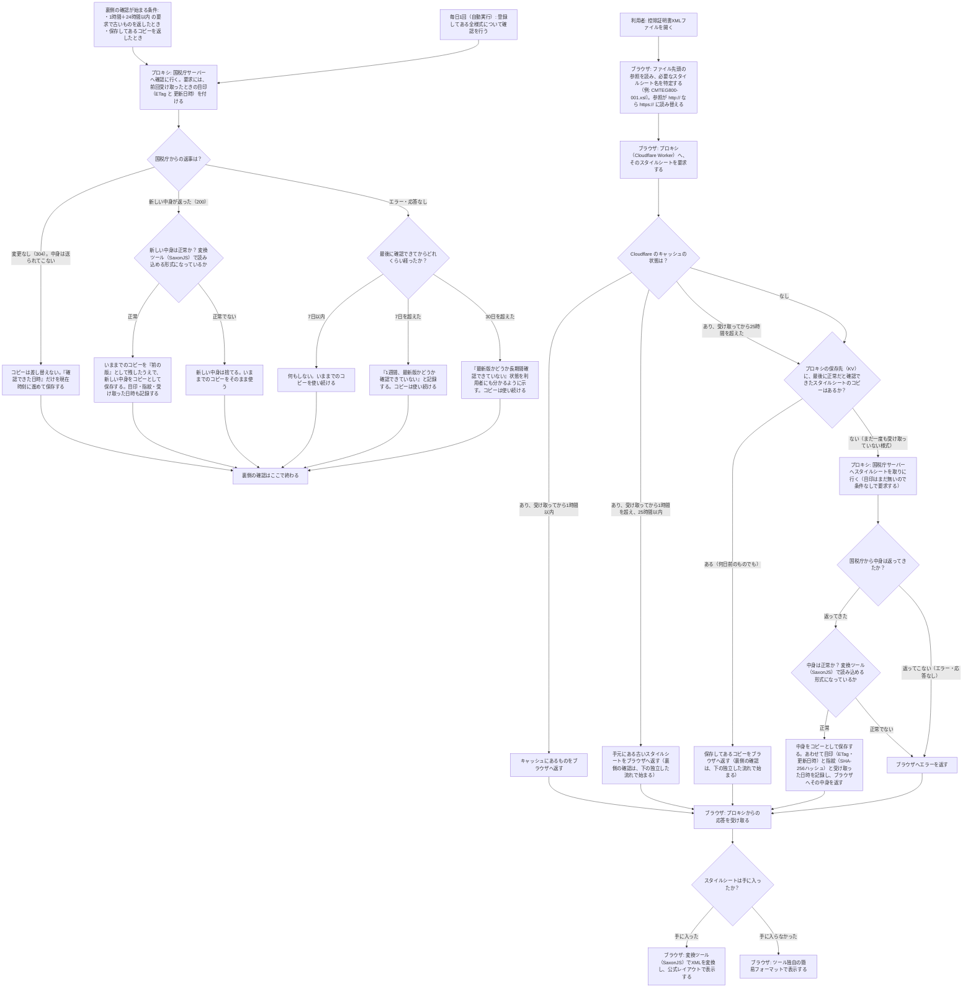

# 控除証明書XMLビューア 公式スタイルシート対応 設計メモ

- 状態: ドラフト（調査・意思決定の記録。実装はこのブランチで Codex と継続する）
- 対象: `src/kojo-xml-viewer/`（公開URL: https://okathira-dev.github.io/client-web-api-sandbox/kojo-xml-viewer/index.html ）
- ブランチ: `feat/kojo-xml-official-stylesheet`
- 最終更新: 2026-11-01

このドキュメントは、公式スタイルシート対応について「やりたいこと」「実測で分かったこと」「決めたこと」「未決のこと」を分けて記録する。推測と実測を混同しないこと。

---

## 1. やりたいこと

現行ビューアは、控除証明書XMLを独自フォーマットで整形表示している（「XML簡易帳票」）。これを、**XMLが本来参照している国税庁の公式スタイルシートで変換し、公式レイアウト（帳票イメージ）で表示できる**ようにする。

要件として同時に満たすもの:

1. 公式スタイルシートで表示できること
2. 様式が改訂されたら、サイトを再デプロイしなくても新しい版に追随できること（動的取得）
3. 利用者のXML本体を端末の外に出さないこと（現行ツールの公約「XMLファイルの外部送信を行いません。すべての処理はクライアントサイドで実行されます」を維持する）

対象範囲はまず控除証明書系の様式（TEG800〜913。生命保険料・地震保険料・国民年金・小規模企業共済・住宅借入金等）とする。

やらないこと:

- XMLのデジタル署名検証（現行通り行わない）
- サーバーサイドでのXML変換（要件3に反する）
- 他人が運営するプロキシの利用（税データ表示に関わるコードを第三者に委ねない）

## 2. 実測で分かったこと（2026-10-30〜11-01）

### 2.1 XML側の参照

実物の生命保険料控除証明書XML（第一生命発行）の先頭は次の通りで、`xml-stylesheet` 処理命令（PI）が国税庁のXSLを指している。

```xml
<?xml version="1.0" encoding="UTF-8"?>
<?xml-stylesheet type="text/xsl" href="http://xml.e-tax.nta.go.jp/xsl/1.0/CMTEG800-001.xsl" ?>
```

### 2.2 HTTPSで直接取得できる（混在コンテンツ問題は読み替えで解ける）

- `https://xml.e-tax.nta.go.jp/xsl/1.0/CMTEG800-001.xsl` は **200** で直接取得できた
  - 126,183 バイト、`Content-Type: application/xslt+xml`
  - `Last-Modified: Sat, 23 May 2026 10:26:44 GMT`
  - `ETag: "1ece7-65279950604c0"`
  - SHA-256: `71bb542f570814a3593a3d930a155c3e7b4af22ab4760d7bc856241b099ec4bb`
  - TEG810 も同様に 200（61,467 バイト）
- `http://` の方は CloudFront が https へ **301 リダイレクト**する。追随して得た本文は、https 直接取得と SHA-256 が一致した
- したがって PI の `http://` は、解決時に `https://` へ**読み替えればよい**。ただし http の 301 リダイレクトに依存してはいけない（http の応答自体は途中で差し替えられ得るため）。最初から https で取りに行くのが正道
- 対象XSL（TEG800）は自己完結している: `xsl:include` / `xsl:import` は無く、`document()` の呼び出しも無い（取得した実ファイルで確認）。サブリソース解決は不要な見込みだが、様式ごとに PoC で確認すること

### 2.3 CORSは依然として壁（プロキシが必要な理由）

- https 側に `Origin` ヘッダーを付けて要求しても、応答に `Access-Control-Allow-Origin` は**付いてこない**（実測）
- サーバーには届き 200 も返るが、別オリジンから fetch した JavaScript は中身を読めない。スキーム読み替えでは解決しない
- `no-cors` では中身が読めず（opaque）、Service Worker でも CORS は回避できない
- 結論: 「公式レイアウト」「動的取得」「XMLを端末から出さない」を同時に満たすには、**自前のプロキシ（サーバー側で取得し、許可ヘッダーを付けて返す中継）が必須**。サーバー同士の取得には CORS が適用されないため成立する
- 将来、国税庁が CORS ヘッダーを付けるようになればプロキシは不要になる。解決処理は「プロキシ経由」決め打ちにせず、差し替え可能な抽象にしておくこと

### 2.4 条件付きリクエストが効く（再検証は安い）

- `If-None-Match`（ETag）付き再要求 → **304・本文0バイト**（実測）
- `If-Modified-Since` 付き再要求 → **304・本文0バイト**（実測）
- 原点は `Cache-Control` を送ってこないため、鮮度方針は全面的にこちらで決める必要がある
- RFC 9111 では、ETag がある場合に `If-None-Match` を送るのはキャッシュの標準動作（MUST）

### 2.5 ブラウザ標準のXSLTは廃止される

- Chrome 公式発表: Chrome 158（2026-11-17）で `XSLTProcessor` と XSLT の PI が Stable で停止予定。Origin Trial / Enterprise Policy は Chrome 176（2027-08-17）まで
  - 出典: https://developer.chrome.com/docs/web-platform/deprecating-xslt
- よって変換エンジンはブラウザ標準に寄らず、JavaScript 実装の **SaxonJS** を使う（§6.3 の未決・確認事項も参照）

### 2.6 公式スタイルシートの配布形態

- 国税庁 e-Tax「電子的控除証明書等に係る仕様書一覧」で、スタイルシート一式が CAB 形式（約132KB）で配布されている。更新日は令和8年5月18日
  - https://www.e-tax.nta.go.jp/shiyo/shiyo-kojo3.htm
- 初期投入（§4 D4）の取得元は、この https 配布（CAB）とする

## 3. アーキテクチャ概要

```text
[ブラウザ: kojo-xml-viewer]
  XMLファイルを読み込む（端末内のみ。外部送信しない）
  PI参照を解析し、様式ファイル名を特定する
  スキームを http → https に読み替える（許可ホストのみ）
        │  XSLの要求のみ（XML本体は送らない）
        ▼
[Cloudflare Worker: XSL専用プロキシ]
  許可リスト（xml.e-tax.nta.go.jp の .xsl のみ）以外は拒否する
  最終正常コピー（KV/R2 に保持）から返す
  鮮度が切れていれば、裏側で条件付きリクエストにより原点を再検証する
        │
        ▼
[原点: xml.e-tax.nta.go.jp（https）]
```

コンポーネント:

| 部品 | 役割 |
|---|---|
| フロントエンド（既存ビューア） | PI解析、XSLの解決依頼、SaxonJS での変換と表示、失敗時の自作フォーマットへのフォールバック、最新性が長期間確認できていない場合の状態表示 |
| Cloudflare Worker | XSL取得のプロキシ。許可リスト検証、CORSヘッダー付与、最終正常コピーの読み書き、条件付き再検証、Cron 巡回 |
| KV または R2 | 最終正常コピーとその付随情報（ETag、Last-Modified、SHA-256、取得日時、最終確認日時、前世代）の保存先 |
| Cloudflare Cron | 1日1回、全様式の巡回再検証（アクセスが無い様式でも改訂検知が止まらないようにするため） |

## 4. 決めたこと

- **D1 方式**: 自前 Cloudflare Worker のプロキシで動的に取得する方式を本命とする。サイトへのXSL同梱はしない（方式選定の経緯: 運用者は既に Cloudflare を利用している）
- **D2 用語**: プロキシが明示的に保持する永続コピーを **「最終正常コピー」**（Last Known Good）と呼ぶ。定義は「差し替えは、取得と検証に成功したときだけ」。対になる Cloudflare のキャッシュは、フロー上の層として扱わない（レスポンスヘッダーで効かせるだけの透過的な高速化であり、設計上の分岐を持たない）
- **D3 更新方式**: 鮮度切れのときは、手持ちのコピーを即座に返し、裏側で再検証する方式（stale-while-revalidate の考え方）を採る。具体的な期間の値は §5 の調査推奨値を置いているが、最終確定は未了とし、詳細設計は実装側（Codex）で詰める
- **D4 同梱と障害範囲**: サイトへの同梱はなし。**Worker 自体の全滅は対策範囲外**とする。その代わり、セットアップ時に、対象様式を一通り最終正常コピーへ**初期投入**しておく（冷たい状態からでも公式レイアウトで表示できるようにするため）
- **D5 プライバシー**: XML本体は Worker を通さない。Worker が扱うのは公開物である XSL のみ。変換は端末内の SaxonJS で行う
- **D6 スキーム読み替え**: PI の参照が許可ホスト（`xml.e-tax.nta.go.jp`）を指す場合のみ、解決時に `http` → `https` へ読み替える。それ以外のホストへの読み替え・プロキシは行わない

フォールバックの順序（全体）:

1. Worker 経由で得た XSL（最終正常コピーを含む）
2. どうしても得られない場合のみ、現行の自作フォーマット

## 5. キャッシュ期間の推奨値（調査済み・最終確定は実装側で）

一次資料（RFC 5861、RFC 9111、Cloudflare 公式ドキュメント）と §2.4 の実測に基づく推奨値。仮に従来置いていた「fresh 5分」は、条件付きリクエストが効く以上、鮮度に対して短すぎると判断した。

| 項目 | 推奨値 | 使われる場所 |
|---|---|---|
| fresh 期間 | 3600秒（1時間） | Worker が返す `Cache-Control: max-age`。この間は原点へ行かない。これが変更検知までの上限になる |
| stale-while-revalidate | 86400秒（24時間） | 同じく `Cache-Control` のディレクティブ。鮮度切れでも即返し＋裏で再検証する窓。利用が疎なツールのため長め（RFC 5861 の注意点: 窓内にリクエストが来ないと再検証自体が発動しない） |
| stale-if-error | 604800秒（7日） | 同じく `Cache-Control` のディレクティブ。原点エラー時に古い応答を返してよい窓（エッジ層の値。永続層は下記の通り無期限） |
| 条件付きリクエスト | 必須で使う | Worker の再検証処理。保存した ETag / Last-Modified を `If-None-Match` / `If-Modified-Since` で送る。304 のときは本文を差し替えず「最終確認日時」だけ更新する |
| Cron 巡回 | 1日1回・全様式 | wrangler の Cron 設定。検知をアクセス量から切り離す |
| 最終正常コピーの有効期間 | **設けない** | KV/R2 の読み出し判定。証明書XMLは様式を名前で参照し続けるため、原点から消えた様式でも過去のXMLには必要で、捨てる判断が正しくなる場面がない |
| 健全性の警告閾値 | 7日 / 30日 | 再検証の成功が7日途絶えたら警告として記録、30日途絶えたら「最新性を確認できていない」状態を明示する。いずれも提供は継続する |
| 前世代の保持 | 1世代 | KV/R2 のキー設計。差し替え時のロールバック用 |

レスポンスヘッダーの形（例）:

```http
Cache-Control: public, max-age=3600, stale-while-revalidate=86400, stale-if-error=604800
Access-Control-Allow-Origin: https://okathira-dev.github.io
Content-Type: application/xslt+xml
```

## 6. 処理フロー

上の流れが「利用者の要求への応答」、下の流れが「裏側の確認」。処理ノードの出口は1本に統一し、枝分かれは判定ノードだけに置くこと。



## 7. 実装の進め方（フェーズと完了条件）

### Phase 0: PoC

- [ ] SaxonJS で、実物XML（TEG800）と公式XSL（TEG800）の変換がブラウザ上で成立することを確認する
  - XSL は XSLT 1.0 形式。SaxonJS は SEF（コンパイル済み形式）が必要になるため、ビルド時に XSL → SEF へ変換する手順（SaxonJS の XX コンパイラ、または Saxon-EE）を確認すること
  - SaxonJS のライセンス条件（HE は無償だがオープンソースではない）を確認すること
- [ ] Worker の最小実装（許可リスト＋素通しプロキシ＋CORS付与）で、ブラウザから XSL が読めることを確認する
- [ ] 変換結果が、公式レイアウトとして既知の出力（帳票イメージ）と一致することを目視で確認する

完了条件: ローカル環境で、実物XMLが公式レイアウトで表示されること。

### Phase 1: Worker の実装

- [ ] 最終正常コピーの保存（KV/R2）と読み出し
- [ ] 条件付きリクエストによる再検証、世代管理（現行＋前世代）
- [ ] 付随情報の記録（ETag、Last-Modified、SHA-256、取得日時、最終確認日時、連続失敗回数）
- [ ] Cron による全様式の巡回再検証と、警告閾値（7日／30日）の記録
- [ ] 初期投入スクリプト（公式CABから対象様式を一通り取り込み、最終正常コピーとして登録する）
- [ ] ログの最小化（XML 本体はもちろん、利用者のXMLに関する情報は扱わない。扱うのは様式名と取得結果のみ）

### Phase 2: フロントエンド統合

- [ ] PI解析と解決処理（スキーム読み替え、許可ホスト判定、Worker 経由の取得）
- [ ] SaxonJS での変換と、公式レイアウト表示タブの追加（既存の簡易帳票と併存）
- [ ] 失敗時の自作フォーマットへのフォールバック
- [ ] 「最新性を確認できていない」状態の表示
- [ ] プライバシー表記の維持確認（XML本体が外部送信されていないこと）

### Phase 3: 公開

- [ ] 対象様式を広げる場合は、様式ごとにサンプルXMLでの変換検証を行ってから追加する
- [ ] README（`src/kojo-xml-viewer/README.md`）へ公式レイアウト表示の説明を追記する

## 8. 未決事項

- **U1 ハッシュ照合の扱い**: 取得したXSLの SHA-256 を「採用の条件（不一致なら使わない）」にするか、「変更検知・記録用」に留めるか
  - 推奨は後者。採用の条件は「検証合格（SaxonJSで読み込めること等）」とする
  - 根拠: 取得経路が https になったため（§2.2）、必須論の主根拠だった「http 経路の改ざん懸念」が弱まったこと。正規の改訂でもハッシュは変わるため、必須にすると動的追随（要件2）と衝突し、手動登録運用に戻ること
  - ハッシュ自体は、変更検知・履歴・前世代へのロールバックのために記録する
- **U2 キャッシュ期間の最終値**: §5 の推奨値を置いたが、実装時に Cloudflare の実挙動（Workers Cache / Cache API の扱い）と合わせて最終確定する
- **U3 保存先の選定**: KV と R2 のどちらを使うか（様式あたり最大でも数百KB程度、件数は様式数×2世代。どちらでも容量は足りる前提で、実装の単純さを優先して決める）
- **U4 SaxonJS の組み込み方式**: ランタイム（ブラウザ用ビルド）の配布方法と、SEF コンパイルをビルド工程のどこに置くか

## 9. リスク・注意点

- XSL の変換結果を DOM に挿入する際の安全性: 原点が https になったとはいえ、外部由来のスタイルシートで生成した HTML を扱う。スクリプト要素等が混入しない前提の確認と、必要に応じた無害化は Phase 0/2 で確認すること
- 国税庁側の仕様変更: 様式ファイル名の付け方（`-001` の版部分）が変わると、PI 参照の解決方法に影響する。解決処理はファイル名のパースに強く依存しすぎないこと
- 再配布への配慮: XSL 自体は公開物だが、サイト側リポジトリへ複製して同梱することはしない方針（D4）

## 10. 出典

- Chrome の XSLT 廃止スケジュール: https://developer.chrome.com/docs/web-platform/deprecating-xslt
- 電子的控除証明書等に係る仕様書一覧（スタイルシート CAB 配布元）: https://www.e-tax.nta.go.jp/shiyo/shiyo-kojo3.htm
- RFC 5861（stale-while-revalidate / stale-if-error）: https://www.rfc-editor.org/rfc/rfc5861.txt
- RFC 9111（HTTP Caching、条件付きリクエスト）: https://httpwg.org/specs/rfc9111.html
- Cloudflare Workers Cache 設定: https://developers.cloudflare.com/workers/cache/configuration/
- 企画書（PDF）: Muse 上の成果物「控除証明書XMLビューア 公式スタイルシート対応 企画書」（A4・9ページ、2026-10-30）。本ドキュメントはその後の実測と決定を反映した実装向けの版
